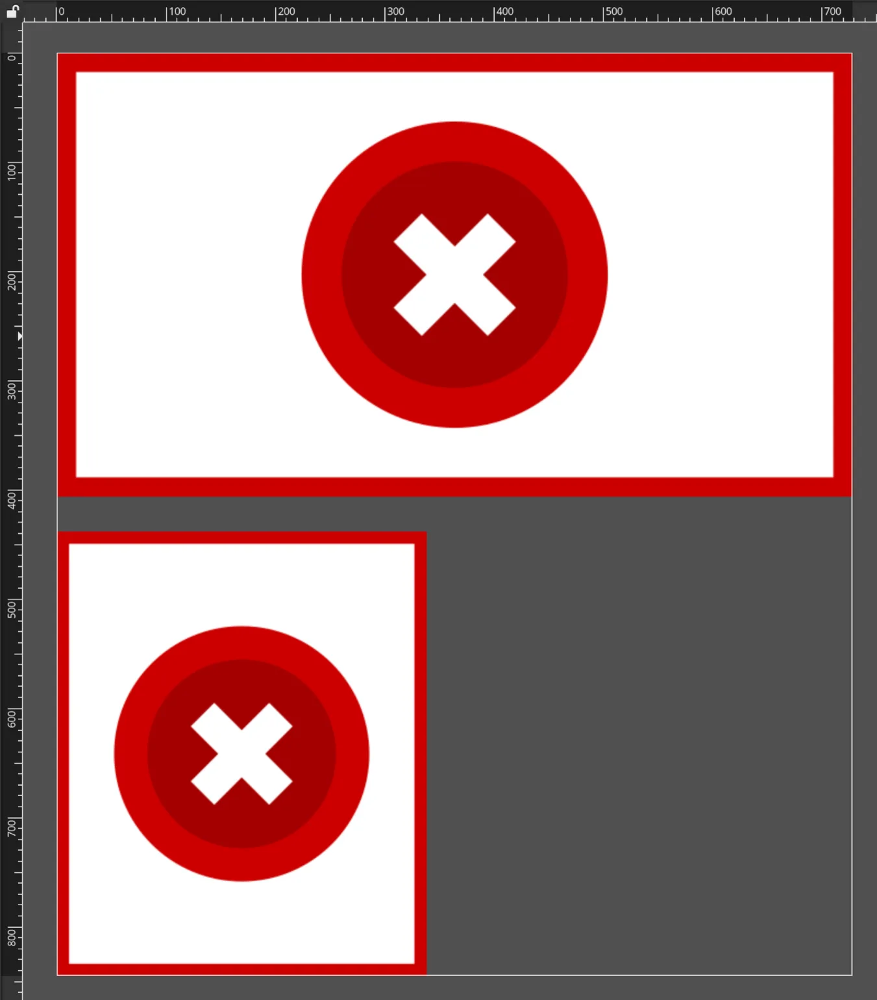
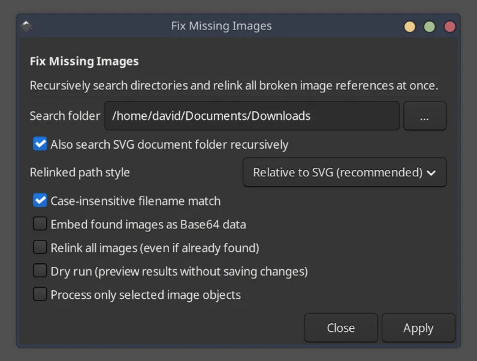
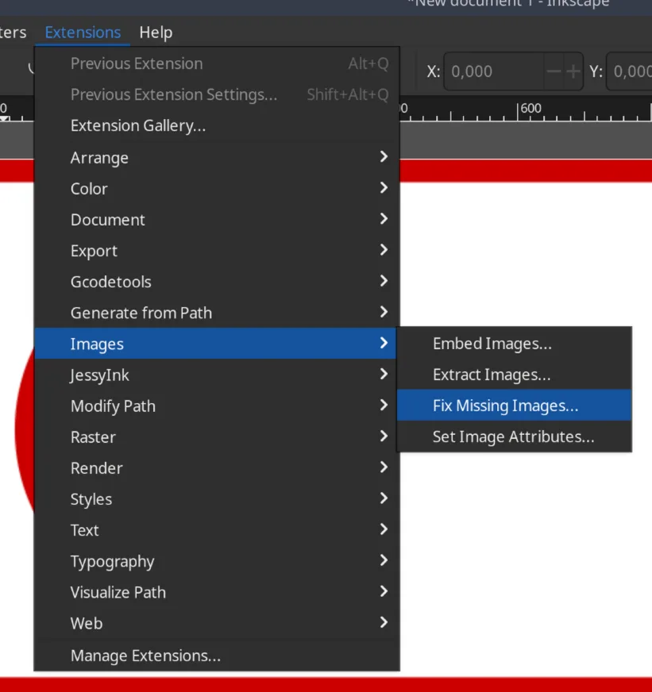
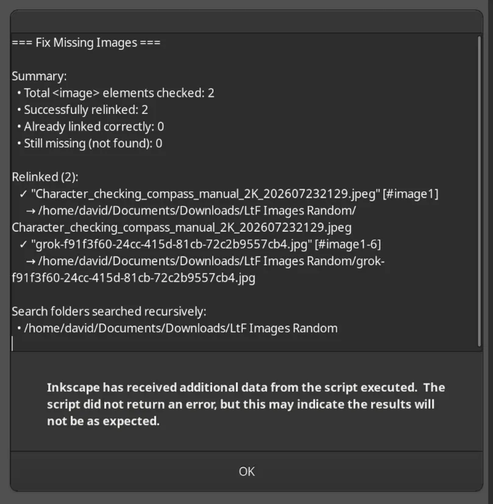
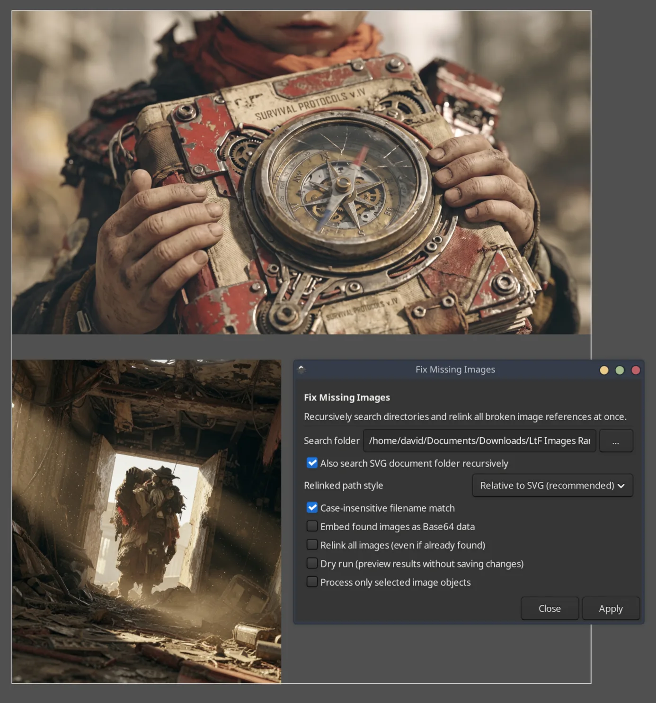
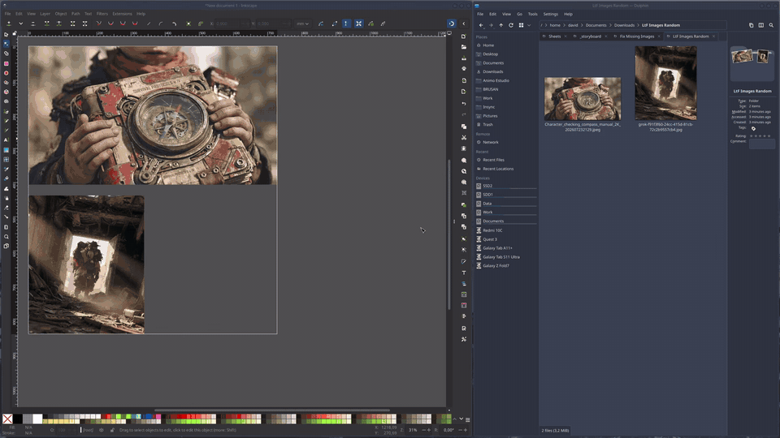

# Fix Missing Images

An Inkscape extension that automatically finds and relinks missing or moved image files recursively all at once.

When SVG files are moved, renamed, or transferred to another computer, linked images break and Inkscape displays a "Linked Image Not Found" placeholder. This extension scans your document, recursively indexes your asset folders in a single fast pass, and relinks every broken image at once.



## Install

Inkscape 1.2 or newer. Developed and tested on 1.4.

```bash
mkdir -p ~/.config/inkscape/extensions
git clone https://github.com/davidbrum25/inkscape-fix-missing-images.git \
  ~/.config/inkscape/extensions/fix-missing-images
```

Restart Inkscape. The command is **Extensions → Images → Fix Missing Images**.

On Windows the extensions folder is `%APPDATA%\inkscape\extensions`.

## Use

1. Open the SVG document with missing or moved images.
2. Open **Extensions → Images → Fix Missing Images**.
3. Select your asset folder in **Search folder** (or leave it blank to search recursively in the SVG document folder), set your preferences, and click **Apply**.









A short screen recording of the whole flow:



The same recording as a smaller video file: [screen_sample.webm](media/screen_sample.webm).

## Options

| Option | What it does |
| --- | --- |
| Search folder | Directory to search recursively for missing image files. If left empty, the SVG document folder is used. |
| Also search SVG document folder recursively | On by default. Also searches inside the folder where the current SVG is saved. |
| Relinked path style | Relative to SVG (recommended) creates portable relative paths. Absolute path creates system-specific full paths. |
| Case-insensitive filename match | On by default. Matches files even if capitalization differs (e.g., `photo.jpg` vs `PHOTO.JPG`). |
| Embed found images as Base64 data | Off by default. Embeds image files directly inside the SVG as Base64 data URIs so they can never be lost again. |
| Relink all images (even if already found) | Off by default. Updates all image paths to the new location, even if they currently exist at their old paths. |
| Dry run (preview results without saving changes) | Off by default. Simulates the search and shows the full report dialog without altering the SVG. |
| Process only selected image objects | Off by default. Only checks and relinks image objects currently selected on the canvas. |

## License

[GPL-2.0-or-later](LICENSE). Same license family as Inkscape's own extensions.
